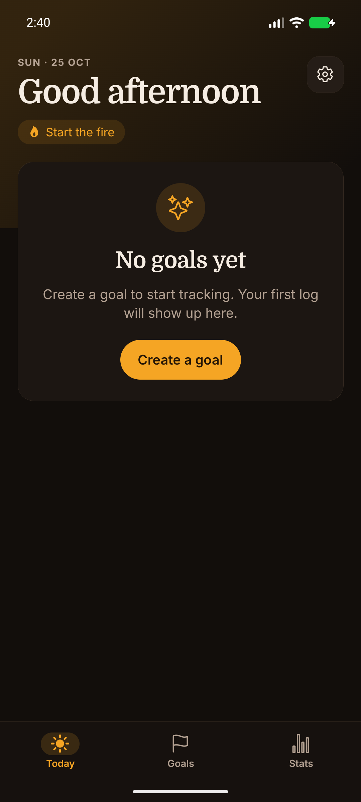
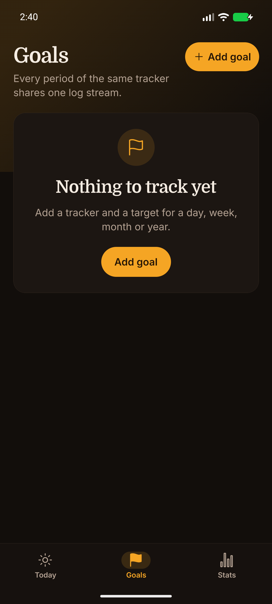
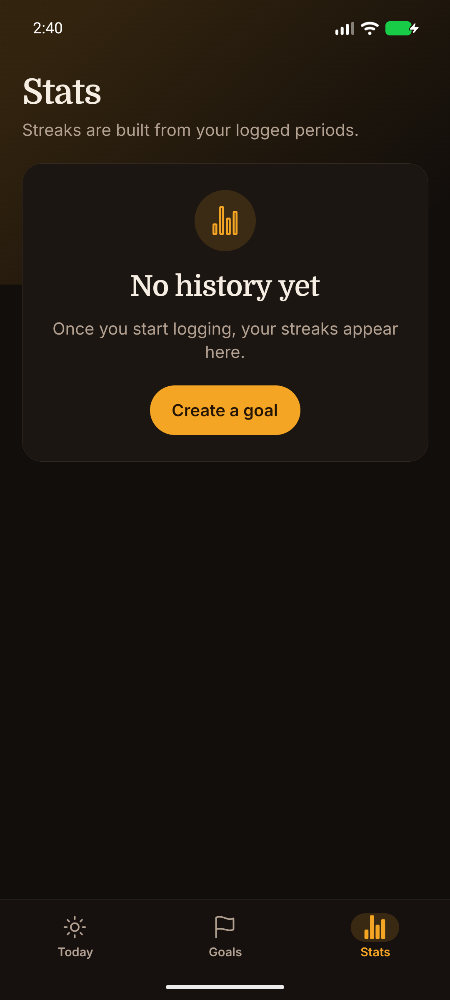
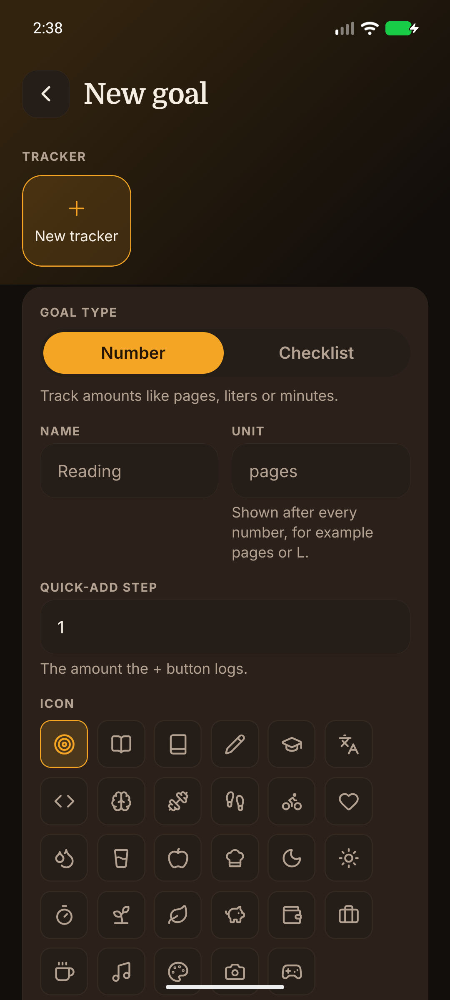

# Goal Tracker

**Goal Tracker is a free, open-source, offline-first habit and goal tracker for Android and iOS.** Create recurring goals, log progress in a few taps, and follow streaks and statistics. No account, no subscription, no ads: every goal, log, and setting stays in a local SQLite database on your device.

[](https://github.com/toprakpt1/goal-tracker/releases/latest)
[](LICENSE)
[](https://github.com/toprakpt1/goal-tracker)
[](https://docs.expo.dev/versions/v58.0.0/)
[](https://github.com/toprakpt1/goal-tracker/actions/workflows/android-apk.yml)

<p align="center">
  
</p>

## Quick facts

| Fact | Detail |
| --- | --- |
| **Price** | Free. No ads, no subscriptions, no in-app purchases. |
| **Platforms** | Android (APK) and iOS (built from source) |
| **Accounts** | None. No sign-up, login, or cloud profile. |
| **Offline** | Yes. Core features work without a network connection. |
| **Data** | On-device SQLite database. Nothing is uploaded. |
| **License** | GNU General Public License v3.0 |
| **Stack** | Expo SDK 58, React Native 0.88, TypeScript, SQLite |

## Why Goal Tracker?

- **No account, no cloud.** Most habit trackers ask you to register and sync to a server. Goal Tracker skips both: your data lives in a local database and never leaves the device.
- **Offline by default.** Logging progress, streaks, statistics, and settings all work in airplane mode. There is no network dependency to break your routine.
- **One log counts everywhere.** A tracker can hold several goals at once, such as a daily reading goal and a weekly page target. Every log counts toward all of them.
- **Goals that match real routines.** Track a habit daily, weekly, monthly, or yearly, and scope a goal to one specific day, week, month, or year when you need a finite challenge.
- **Open source and auditable.** The full source is public under GPL-3.0. You can inspect what the app does, build it yourself, or fork it.

## Features

### Track anything you want to improve

Create a tracker for reading, exercise, water intake, language practice, or any other routine. Each tracker has a name, unit, icon, color, and a default quick-add step.

### Check off or measure progress

Use **checklist goals** when completing the habit is the point, or **numeric goals** when you want to log amounts such as pages, liters, minutes, or repetitions. Both types appear on the Today screen.

### Set targets for any period

Every goal can target a day, week, month, or year. A single tracker can carry multiple goals, and they all share the same log stream. Changing the week start in Settings does not rewrite existing history.

### Schedule a goal for a specific period

Recurring goals apply to every period. Scheduled goals apply only to a chosen window, which is useful for challenges like "read every day in November" or "run three times this week".

### Follow streaks and statistics

The Stats screen shows active streaks, best streaks, tracked goals, and completed periods. Streaks are calculated from logged periods, including month and year goals.

### Add reminders and notes

Give any goal an optional daily reminder time. Add a note to a goal to record why it matters, and attach a short note to individual log entries.

### Make it yours

Choose a light, dark, or system theme, set the week to start on Monday or Sunday, toggle haptics, load example data, and reset everything from Settings.

## How it works

Goal Tracker uses three simple concepts:

| Concept | What it means |
| --- | --- |
| **Tracker** | The thing you measure, such as Reading or Water. It stores the unit, icon, color, and quick-add step. |
| **Goal** | A target for a tracker in a period. One tracker can have a daily goal, a weekly goal, and a scheduled goal at the same time. |
| **Log** | A recorded amount or a completed check. Logs count toward every goal on that tracker, inside the goal's period and scope. |

This is why the app can show one log on the Today screen and still feed several targets: the log belongs to the tracker, while progress is calculated per goal.

## Install

### Android (APK)

1. Open the [latest release](https://github.com/toprakpt1/goal-tracker/releases/latest).
2. Download `goal-tracker-<version>.apk`.
3. Optionally verify the download with the matching `.sha256` file.
4. Allow installs from your browser or file manager, then open the APK.

The APK is a release build for sideloading and testing. Goal Tracker is not published on Google Play yet.

### iOS

An App Store build is not available yet. The project supports iOS and can be built from source with Xcode:

```bash
npx expo prebuild --platform ios
npx expo run:ios
```

### Build from source

Requirements: Node.js LTS, npm, and an Android emulator, iOS simulator, physical device, or a development build.

```bash
git clone https://github.com/toprakpt1/goal-tracker.git
cd goal-tracker
npm install
npx expo start
```

Then open the project in Expo Go, an emulator, a simulator, or a development build. For native modules, prefer a development build:

```bash
npx expo run:android
npx expo run:ios
```

Native `ios/` and `android/` directories are generated and are not maintained in this repository.

## Usage

1. Open the **Goals** tab and create a tracker, or pick an existing one.
2. Add a checklist or numeric goal and choose its target period.
3. Use the **Today** tab to tick a goal off or log numeric progress.
4. Open a goal to review progress, notes, and recent logs.
5. Visit **Stats** to see completion totals, current streaks, and best streaks.
6. Configure week start, theme, reminders, and haptics in **Settings**.

## Screenshots

Captured from the Android emulator while running the app through Expo.

| Today | Goals |
| --- | --- |
|  |  |

| Stats | New Goal |
| --- | --- |
|  |  |

## Tech stack

| Layer | Technology |
| --- | --- |
| Framework | [Expo](https://expo.dev) SDK 58, React Native 0.88 |
| Language | TypeScript |
| Navigation | [Expo Router](https://docs.expo.dev/router/introduction/) with file-based routes |
| Storage | [expo-sqlite](https://docs.expo.dev/versions/v58.0.0/sdk/sqlite/) with versioned migrations |
| State | [Zustand](https://zustand.docs.pmnd.rs/) |
| Dates | [date-fns](https://date-fns.org/) |
| Icons | [Lucide React Native](https://lucide.dev/) and Expo vector icons |
| Notifications | expo-notifications with locally scheduled reminders |
| Tests | Jest and jest-expo |

The codebase is also a compact reference for a typed Expo Router app with a SQLite repository layer, domain-level period and streak logic, and tests that cover daylight-saving-time boundaries.

## Project structure

```text
src/
├── app/          # Expo Router screens and layouts
├── components/   # Reusable mobile UI components
├── db/           # SQLite schema, migrations, queries, and repositories
├── domain/       # Goal periods, progress, scopes, and streak calculations
├── hooks/        # Data and settings hooks
├── i18n/         # User-facing strings
├── lib/          # Notifications, formatting, icons, and app utilities
├── store/        # Local application state
└── theme/        # Colors, typography, spacing, and theme helpers
```

## Testing

```bash
npm test        # unit tests plus daylight-saving-time boundary tests
npm run lint
npm run typecheck
```

The suite covers progress, streaks, periods, scoped goals, and daylight-saving-time transitions. It runs once in `Europe/Istanbul` and once in `America/New_York` to catch timezone bugs.

## FAQ

### Is Goal Tracker free?

Yes. Goal Tracker is free and open source under the GNU GPL v3.0. There are no ads, subscriptions, in-app purchases, or paid tiers. You can download the Android APK from GitHub Releases, build it yourself, or fork the source.

### Does Goal Tracker work offline?

Yes. Creating trackers, logging progress, streaks, statistics, reminders, and settings all work without an internet connection. Data is stored in a local SQLite database, and reminders are scheduled locally on your device.

### Do I need an account?

No. There is no sign-up, login, email, or cloud profile. Open the app and start creating goals. Because there is no account, there is also no password to lose and no profile data to leak.

### Is there an iPhone or iOS version?

The codebase supports iOS and can be built from source with Xcode, but there is no App Store release yet. Android is the primary distribution channel today, with APK builds published on GitHub Releases.

### Where is my data stored?

Goals, logs, notes, and settings live in a local SQLite database (`goaltracker.db`) inside the app's private storage. Nothing is uploaded to a server. Uninstalling the app or choosing **Reset all data** permanently deletes it.

### Can I sync between devices?

Not today. Goal Tracker is intentionally local-only, so there is no account or cloud sync. Data export and import are on the roadmap, which will make it possible to move data between devices manually.

### Can I track numeric habits like pages, liters, or minutes?

Yes. Numeric goals have a unit and a target, and the quick-add step controls how much the + button logs. You can also create checklist goals that are simply ticked off when completion itself is the goal.

### Does it support reminders?

Yes. Each goal can have an optional daily reminder time, delivered as a local notification. Reminders work offline. You can turn notifications off in Settings, and the app asks for permission before scheduling anything.

### Is it on Google Play?

Not yet. Android builds are published as APK files on the GitHub Releases page, and each release includes a SHA-256 checksum. Installing one requires allowing installs from your browser or file manager.

### What languages does the interface support?

English only at the moment. All user-facing strings live in `src/i18n/strings.ts`, so adding another language does not require changes to individual screens. Localization is not scheduled on the roadmap yet.

### Is Goal Tracker open source? Can I contribute?

Yes. The project is licensed under GPL-3.0 and the full source is on GitHub. Bug reports, feature requests, and pull requests are welcome. Run `npm run lint`, `npm run typecheck`, and `npm test` before opening a pull request.

## Roadmap

- [x] Goal and tracker management
- [x] Daily, weekly, monthly, and yearly goals
- [x] Quick progress logging and undo
- [x] Streak and statistics views
- [x] Local notifications and reminders
- [x] Offline-first SQLite storage
- [x] Scheduled goals and notes
- [ ] Data export and import
- [ ] Home-screen widgets
- [ ] More customization options

Suggestions and known issues are welcome in [GitHub Issues](https://github.com/toprakpt1/goal-tracker/issues).

## Contributing

Contributions are welcome. To propose a change:

1. Fork the project.
2. Create a feature branch (`git checkout -b feature/amazing-feature`).
3. Commit your changes (`git commit -m 'Add some amazing feature'`).
4. Push the branch (`git push origin feature/amazing-feature`).
5. Open a pull request.

Please run `npm run lint`, `npm run typecheck`, and `npm test` before submitting a pull request. Small, focused pull requests are easiest to review.

## Privacy and data

Goal Tracker is designed to keep your data on your device:

- Goal data, logs, notes, settings, and statistics are stored locally in SQLite.
- Core functionality does not require an internet connection.
- Notifications are optional and can be disabled in Settings.
- The project includes no analytics, advertising, tracking, or third-party data collection.

## License

Distributed under the [GNU General Public License v3.0](LICENSE).

## Contact

Toprak Talha Karcılar — [@toprakpt1](https://github.com/toprakpt1)

Project link: [https://github.com/toprakpt1/goal-tracker](https://github.com/toprakpt1/goal-tracker)

If Goal Tracker is useful to you, starring the repository helps other people find it.
